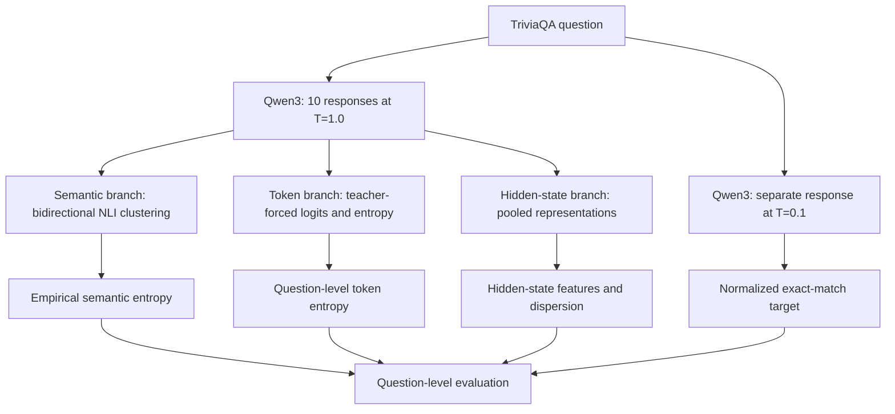

# LLM Uncertainty Signals for Correctness Prediction

Research code exploring whether **semantic uncertainty, token-level predictive uncertainty, and internal hidden-state representations** contain useful information for predicting the correctness of an LLM answer.

The project is inspired by Farquhar et al. (2024), *Detecting Hallucinations in Large Language Models Using Semantic Entropy*. It is an **experimental adaptation and extension**, not an exact reproduction of the paper's probability-weighted semantic entropy estimator.

> **Research status (7 November 2026):** Core experiments have been run on a 100-question TriviaQA sample using Qwen3-1.7B. The results are exploratory. This repository does not yet demonstrate a general-purpose, calibrated hallucination detector or generalization across models and datasets.

## Research question

Can signals extracted from multiple high-temperature responses and the model's internal representations help predict whether a separate low-temperature answer matches a reference answer?

The experiment uses a **cross-temperature, question-level** design:

- Ten responses generated at temperature 1.0 provide the features.
- One separate response generated at temperature 0.1 provides the target label.
- One question is one labelled observation. The ten sampled responses are not treated as ten independent correctness-labelled examples.
- The target is normalized reference-based exact-match correctness, not human-verified factual truth.

## Experimental setup

| Property | Configuration |
|---|---|
| Dataset | TriviaQA, `unfiltered.nocontext` validation sample |
| Questions | 100 |
| High-temperature responses | 10 per question; 1,000 total |
| Separate low-temperature target responses | 1 per question; 100 total |
| Correct / incorrect targets | 27 / 73 |
| Base model | Qwen3-1.7B |
| Quantization | 4-bit NF4, double quantization |
| Compute dtype | FP16 |
| Few-shot examples | 5 |
| High-temperature generation | T = 1.0, top-p = 0.8, top-k = 20 |
| Low-temperature generation | T = 0.1 |
| Maximum new tokens | 64 |
| Qwen3 thinking mode | Disabled |
| NLI model | `cross-encoder/nli-deberta-v3-small` |

Correctness normalization lowercases the answer, removes ASCII punctuation and articles, and collapses whitespace before exact-match comparison. Exact match is a strict reference-based proxy: a factually valid paraphrase may still be labelled incorrect.

## Research pipeline



## Methods

### 1. Empirical semantic entropy

For each question, the ten high-temperature answers produce 45 unordered pairs. Each pair is evaluated in both directions using question-conditioned NLI. Two answers are treated as mutually entailing only when both directional predictions are entailment and each entailment score is at least 0.5.

The clustering algorithm is **greedy first-compatible complete linkage**: a new answer joins the first existing cluster only if it passes the mutual-entailment criterion against every member of that cluster. Otherwise, it starts a new cluster.

If cluster $i$ contains $n_i$ of the ten answers, its empirical frequency is $p_i=n_i/10$. The score is Shannon entropy over those frequencies:

$$
H_{\mathrm{emp}}(q)=-\sum_{i=1}^{K}p_i\ln p_i.
$$

This is **empirical semantic-cluster entropy**. It estimates cluster probabilities from observed sample frequencies; it is not the original paper's probability-weighted semantic entropy, which aggregates model sequence probabilities within meaning clusters.

### 2. Token predictive entropy

Saved answers are reconstructed with their prompts and passed through Qwen3 using teacher forcing. For answer token position $p$, logits at causal predictor position $p-1$ are converted into a raw full-vocabulary softmax distribution. Shannon entropy is calculated at selected answer-token prediction positions, averaged within each answer, and then averaged across the ten answers to obtain one scalar per question.

The vocabulary probability is obtained from logits $z_{t,v}$ using softmax:

$$
P(v\mid x_{<t})=
\frac{\exp(z_{t,v})}
{\sum_{j=1}^{V}\exp(z_{t,j})}.
$$

The predictive entropy at position $t$ is:

$$
H_t=-\sum_{v=1}^{V}P(v\mid x_{<t})\ln P(v\mid x_{<t}).
$$

Important qualifications:

- The calculation uses raw full-vocabulary softmax probabilities, not the top-k/top-p-filtered distribution used during the original sampling process.
- Prompt and answer are tokenized jointly. Answer-overlapping token positions are selected using character-offset overlap.
- 347 of the 1,000 answers contained a token crossing the prompt/answer boundary. Those tokens were retained in the primary calculation and examined separately in a boundary-sensitivity analysis.
- EOS was not appended or scored during this reconstruction.

The reported token-entropy score is the **question-level mean of the ten answer-level mean token entropies**. Other descriptive summaries were not used for the headline raw-score metrics.

### 3. Hidden-state representations

The original hidden-state extraction stores 29 hidden-state indices and four pooling strategies (`first`, `last`, `mean`, `max`). The indices are:

- Index 0: embedding output.
- Indices 1-27: decoder-block outputs 1-27.
- Index 28: final RMSNorm-normalized output.

The hidden dimension is 2,048. The per-answer tensor has shape `(1000, 29, 4, 2048)` and was stored as float16. Ten answer representations are averaged in float32 to create the question-level tensor with shape `(100, 29, 4, 2048)`.

Two token alignments were investigated separately:

- **Predictor-state (`p-1`)**: the representation at the causal position used to predict an answer token.
- **Post-token (`p`)**: the representation at the selected answer-token position, after that token has been incorporated into the context.

These are different representations and are not interchangeable. Hidden-state vectors are learned internal representations; they are not inherently calibrated uncertainty scores.

For an answer with $T$ selected token representations $h_t$, mean pooling produces one answer vector:

$$
z_r=\frac{1}{T}\sum_{t=1}^{T}h_t.
$$

The first, last, and max pooling strategies use different summaries of the token representations.

### 4. Within-question hidden-state dispersion

A mean representation captures the average location of the ten answer vectors, but it does not capture how much those vectors vary around that mean. For vectors $z_{q,1},\ldots,z_{q,10}$, the centroid is:

$$
\mu_q=\frac{1}{10}\sum_{r=1}^{10}z_{q,r}.
$$

Dispersion is the mean Euclidean distance from that centroid:

$$
D_q=\frac{1}{10}\sum_{r=1}^{10}
\left\|z_{q,r}-\mu_q\right\|_2.
$$

The post-token and predictor-state dispersion experiments use this within-question variation as an additional feature. This metric is an average Euclidean distance, **not variance**.

### 5. Predictive probes

A logistic-regression probe tests whether selected features contain information associated with the separate low-temperature correctness label. The probe is separate from Qwen3; it does not fine-tune the language model.

For a feature vector $x_q$, the probe estimates:

$$
P(y_q=1\mid x_q)=\sigma(w^\top x_q+b),
$$

where the sigmoid function is:

$$
\sigma(u)=\frac{1}{1+\exp(-u)}.
$$

The evaluator converts the out-of-fold probability of correctness into an uncertainty score:

$$
U_q=1-P(y_q=1\mid x_q).
$$

Higher $U_q$ means the probe assigns a lower probability to the separate low-temperature answer being correct. The evaluated inputs include single entropy features, both entropy features together, hidden-state vectors, and hidden-state-plus-entropy combinations.

## Results

Two evaluation protocols are reported separately. **Direct raw-score evaluation** ranks each uncertainty score itself. **Predictive-probe evaluation** trains logistic-regression models and ranks out-of-fold probabilities. Their AUROC and AURAC values must not be mixed.

### A. Direct raw-score evaluation

Higher uncertainty is treated as a stronger rejection score. AUROC treats incorrectness as the positive class. Spearman is calculated against the correctness label (1 = correct). AURAC measures retained accuracy as the highest-uncertainty questions are rejected first.

| Raw signal | Spearman vs correctness | AUROC (incorrectness) | AURAC |
|---|---:|---:|---:|
| Empirical semantic entropy | -0.528199 | 0.841451 | 0.462878 |
| Token predictive entropy | -0.541147 | 0.851852 | 0.537749 |
| Post-token dispersion, index 28 / mean pooling | -0.397458 | 0.757991 | 0.435888 |

Post-token dispersion standalone 95% bootstrap intervals (20,000 question-level resamples, seed `20261031`):

| Metric | Point estimate | 95% interval |
|---|---:|---:|
| Spearman | -0.397458 | [-0.560431, -0.207661] |
| AUROC | 0.757991 | [0.638400, 0.862871] |
| AURAC | 0.435888 | [0.297484, 0.574907] |

The raw token-entropy point estimates are higher than the raw semantic-entropy point estimates, but paired question-level bootstrap intervals included zero for the differences in Spearman, AUROC and AURAC. The experiment did not establish statistical superiority of one raw entropy signal over the other.

### B. Initial nested-CV predictive-probe screening

The initial screening evaluated 235 configurations:

- 116 hidden-only configurations (29 hidden-state indices × 4 pooling strategies).
- 3 entropy baselines (semantic, token, and semantic + token).
- 116 hidden-state-plus-both-entropy configurations.

| Configuration | AUROC | AURAC | Spearman | Accuracy | F1 |
|---|---:|---:|---:|---:|---:|
| Semantic entropy only | 0.838153 | 0.479576 | -0.521014 | 0.73 | 0.000000 |
| Token entropy only | 0.802131 | 0.479362 | -0.464677 | 0.73 | 0.000000 |
| Semantic + token entropy | 0.821918 | 0.494675 | -0.495109 | 0.77 | 0.342857 |
| Best hidden-only by AUROC: `hidden_state_28_mean` | 0.771689 | 0.462826 | -0.417858 | — | — |
| Best hidden + entropy by AUROC: `hidden_state_28_mean_plus_entropy` | 0.804668 | 0.481866 | -0.468578 | — | — |

**Protocol:** question-level nested 2-fold stratified cross-validation, shuffled, random seed `20261106`; `StandardScaler` inside the training-fold pipeline; logistic regression with `lbfgs`, `max_iter=1000`, and $C\in\{0.1,1.0\}$, selected by inner-fold AUROC. The 235 configurations produced 23,500 out-of-fold predictions.

The initial 235-configuration screening used 100 question-level bootstrap resamples (seed `20261106`). The intervals are preliminary and do not correct for screening 116 hidden-state alternatives. The best hidden-only and hidden-plus-entropy configurations by AURAC were different from the AUROC-leading configurations; a “best” configuration must name the metric.

### C. Dispersion as an additional predictive feature

A follow-up compared the semantic + token entropy baseline with the same two features augmented by either predictor-state (`p-1`) or post-token (`p`) dispersion at hidden-state index 28 with mean pooling.

| Configuration | AUROC | AURAC | Spearman | Accuracy | Precision | Recall | F1 |
|---|---:|---:|---:|---:|---:|---:|---:|
| Semantic + token entropy | 0.821918 | 0.494675 | -0.495109 | 0.77 | 0.7500 | 0.2222 | 0.3429 |
| + predictor-state dispersion (`p-1`) | **0.839168** | **0.515165** | **-0.521639** | **0.79** | 0.6500 | **0.4815** | **0.5532** |
| + post-token dispersion (`p`) | 0.832065 | 0.509229 | -0.510715 | 0.77 | 0.6111 | 0.4074 | 0.4889 |

Paired bootstrap differences on the same out-of-fold questions (20,000 resamples, seed `20261106`):

| Comparison | AUROC difference (95% interval) | AURAC difference (95% interval) |
|---|---:|---:|
| Predictor-state dispersion minus entropy baseline | +0.017250 [-0.028171, 0.069498] | +0.020489 [-0.020937, 0.068204] |
| Post-token dispersion minus entropy baseline | +0.010147 [-0.033532, 0.058134] | +0.014554 [-0.027417, 0.060537] |
| Post-token minus predictor-state dispersion | -0.007103 [-0.023392, 0.007905] | -0.005936 [-0.020819, 0.004436] |

Predictor-state dispersion produced the strongest numerical point estimates in this comparison. However, the paired AUROC and AURAC intervals include zero. The experiment therefore does **not** establish statistically supported incremental improvement or a reliable advantage of `p-1` over `p`. Threshold-dependent metrics such as recall and F1 are exploratory and should not override the inconclusive ranking-metric comparisons.

## Robustness checks and implementation audits

- **Clustering order sensitivity:** 1,000 answer-order permutations per question (100,000 shuffled runs). Seven questions changed cluster partitions; five showed entropy variation. The maximum within-question entropy range was 0.347929 nats.
- **Connected-components comparison:** greedy complete linkage achieved AUROC 0.841705 and AURAC 0.462878; connected components achieved AUROC 0.838407 and AURAC 0.465753. The partitions differed on seven questions.
- **Manual NLI review:** 44 unique pairs across 37 questions; TP=19, FP=1, FN=1, TN=23 (accuracy 95.45%, precision 0.95, recall 0.95, F1 0.95). This was a small, one-annotator review with pairs nested within questions and a sample selected using model predictions; it is not a definitive human benchmark.
- **Token-boundary sensitivity:** 347/1,000 answers contained a boundary-crossing token. The sensitivity variant had Spearman 0.706155 with the primary entropy values and mean absolute difference 0.230639 nats. It is not an exact answer-only conditional likelihood.
- **Hidden-state alignment:** controlled checks showed why `p-1` vectors can be identical for answers that differ only at the next token, while post-token `p` vectors can distinguish those answers. This is consistent with causal predictor-position semantics, not evidence of an indexing bug.

## Repository structure

```text
.
├── configs/                         # Experiment configurations
├── data/
│   ├── annotations/                 # Manual annotation material
│   ├── examples/                    # Small example inputs
│   └── generated/                   # Tracked result summaries and selected artifacts
├── docs/
│   ├── architecture/
│   ├── experiments/
│   └── methodology/
├── results/
│   ├── baselines/
│   ├── hidden_states/
│   └── predictive_probes/
├── scripts/
│   ├── analysis/
│   ├── data/
│   ├── evaluation/
│   ├── hidden_states/
│   ├── semantic/
│   └── token_entropy/
├── src/uncertainty/                 # Research package modules
├── tests/                           # Test suite (currently incomplete)
├── requirements.txt
├── pyproject.toml
└── README.md
```

### Key implementation files

| Research stage | Main script |
|---|---|
| TriviaQA dual-temperature generation | [`scripts/data/generate_data.py`](scripts/data/generate_data.py) |
| NLI semantic clustering | [`scripts/semantic/cluster_answers.py`](scripts/semantic/cluster_answers.py) |
| Semantic entropy evaluation | [`scripts/semantic/evaluate_semantic_entropy.py`](scripts/semantic/evaluate_semantic_entropy.py) |
| Teacher-forced token scoring | [`scripts/token_entropy/score_teacher_forced.py`](scripts/token_entropy/score_teacher_forced.py) |
| Token entropy calculation | [`scripts/token_entropy/calculate_token_entropy.py`](scripts/token_entropy/calculate_token_entropy.py) |
| Predictor-state hidden-state extraction | [`scripts/hidden_states/extract_hidden_state_features.py`](scripts/hidden_states/extract_hidden_state_features.py) |
| Initial predictive-probe screening | [`scripts/evaluation/evaluate_hidden_state_predictive.py`](scripts/evaluation/evaluate_hidden_state_predictive.py) |
| Post-token hidden-state extraction / dispersion | [`scripts/hidden_states/evaluate_post_token_hidden_state_dispersion.py`](scripts/hidden_states/evaluate_post_token_hidden_state_dispersion.py) |
| Post-token dispersion predictive test | [`scripts/hidden_states/evaluate_post_token_dispersion_predictive.py`](scripts/hidden_states/evaluate_post_token_dispersion_predictive.py) |
| Predictor-state vs post-token comparison | [`scripts/hidden_states/evaluate_predictor_vs_post_token_dispersion.py`](scripts/hidden_states/evaluate_predictor_vs_post_token_dispersion.py) |

### Selected result reports

- [`data/generated/post_token_dispersion_predictive_evaluation_report.md`](data/generated/post_token_dispersion_predictive_evaluation_report.md)
- [`data/generated/predictor_vs_post_token_dispersion_report.md`](data/generated/predictor_vs_post_token_dispersion_report.md)
- [`results/predictive_probes/README.md`](results/predictive_probes/README.md)

Large model weights, the complete generated-answer corpus, and all original hidden-state NPZ tensors are not included in the repository snapshot. The tracked generated-data directory contains selected summaries and artifacts, not every input required to reproduce every experiment from scratch.

## Installation and execution notes

The package metadata requires **Python 3.10 or newer**. A CUDA-compatible PyTorch and bitsandbytes installation is needed for the local quantized Qwen3 experiments. Install a PyTorch build appropriate for your OS, CUDA driver and hardware; a generic dependency installation does not configure CUDA for every machine.

```bash
git clone https://github.com/Tirth-2006/semantic-entropy-hallucination-detection.git
cd semantic-entropy-hallucination-detection

python -m venv .venv

# Windows PowerShell
.venv\Scripts\Activate.ps1

# Linux / macOS
source .venv/bin/activate

python -m pip install --upgrade pip
python -m pip install -r requirements.txt
python -m pip install -e .
```

**Important before running model-backed scripts:** the current code still contains machine-specific model-directory settings. In particular, `src/uncertainty/config.py` has a local Windows path, and some analysis scripts make their own model-directory assumptions. Update these to point to the local Qwen3-1.7B model directory before running the relevant stages. Some experiment scripts also require previously generated JSON/CSV/NPZ artifacts. A fresh clone is therefore not yet a one-command reproduction of all reported experiments.

The repository's script entry points are listed in the table above. Run them from the repository root and check each script's input/output constants before execution; the exact paths depend on which saved artifacts are available locally.

## Current engineering status

The latest GitHub Actions run on 7 November 2026 installed the listed dependencies successfully but failed at `python -m pytest -q` with exit code 5 because no tests were collected. The files currently under `tests/` are not yet a functioning automated pytest suite. **CI is not green at this snapshot.** Offline unit tests and a clean model-path configuration are still needed before presenting the repository as fully reproducible.

Other reproducibility limitations include:

- The exact Qwen checkpoint revision/hash was not recorded.
- Generation-time token log-probabilities and filtered sampling distributions were not saved, so original generation probabilities cannot be reconstructed exactly.
- The NLI entailment threshold is a chosen heuristic and has not been calibrated on a large human-labelled set.
- The hidden-state screening considered 116 alternatives without multiplicity-adjusted inference.

## Interpretation and limitations

1. The sample contains only 100 questions and 27 correct target labels; estimates and model selection can be unstable.
2. Only one model family/size (Qwen3-1.7B) and one TriviaQA slice have been evaluated.
3. The target is normalized reference-based exact match, not human-verified factual truth.
4. This is cross-temperature prediction: features come from T=1.0 responses, while the target belongs to a separate T=0.1 response.
5. Token scores and hidden states are reconstructed from saved answers and prompts through teacher forcing; they were not captured from the original generation-time forward passes.
6. Token entropy uses raw full-vocabulary softmax and does not reproduce the original top-k/top-p sampling distribution.
7. Greedy complete-linkage clustering is order-dependent, and NLI entailment is only a proxy for semantic equivalence.
8. The 235-configuration screen is exploratory and subject to selection optimism.
9. Paired bootstrap intervals for the later probe comparisons are calculated from fixed out-of-fold predictions; the probe models are not retrained inside each bootstrap resample.
10. No independent dataset, model-family or task validation has yet been established.

Accordingly, the results support **exploratory associations in this sample**, not a deployed hallucination detector, calibrated uncertainty estimate, causal explanation, or generalization claim.

## References

- Farquhar et al. (2024). [Detecting Hallucinations in Large Language Models Using Semantic Entropy](https://www.nature.com/articles/s41586-024-07421-0). *Nature*.
- [Official semantic uncertainty implementation](https://github.com/jlko/semantic_uncertainty).
- [Qwen3-1.7B model](https://huggingface.co/Qwen/Qwen3-1.7B).
- [TriviaQA dataset](https://huggingface.co/datasets/mandarjoshi/trivia_qa).

## Citation

See [`CITATION.cff`](CITATION.cff). When discussing the semantic-entropy framework, cite Farquhar et al. (2024) and describe this repository as an experimental adaptation.

## License

See [`LICENSE`](LICENSE).
