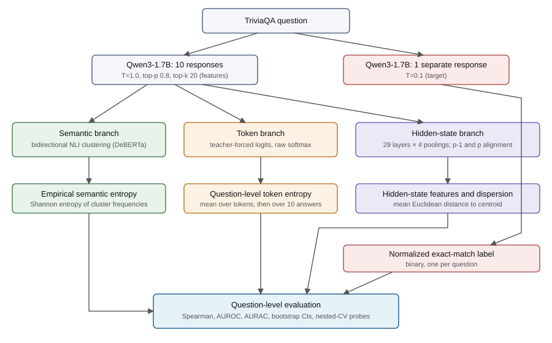
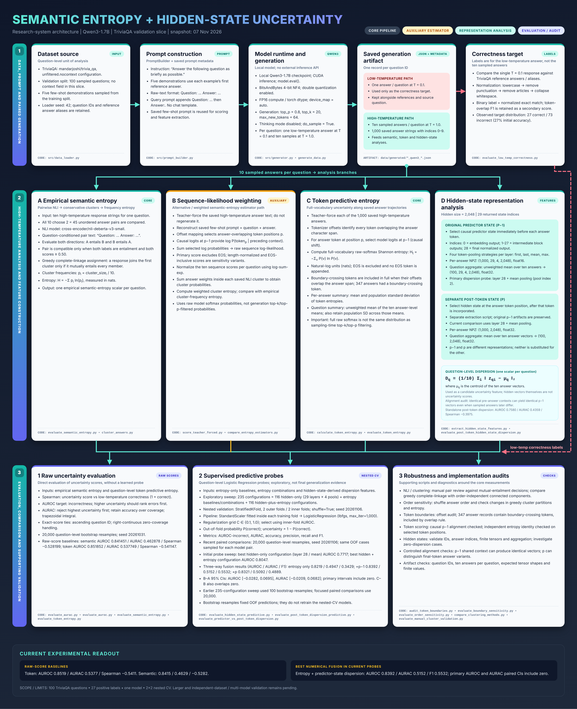

# Architecture



*Figure: question-level pipeline. Ten high-temperature (T = 1.0) responses feed three signal
branches (semantic, token, hidden-state). Each produces one scalar or feature vector per question,
which is evaluated against a binary exact-match label from a separate low-temperature (T = 0.1)
answer. Direct raw-score ranking and out-of-fold probe evaluation are reported separately.*

## Code layout

```text
src/uncertainty/             installable package (reusable logic, no dependency on scripts/)
├── config.py                configuration; model directory via UNCERTAINTY_MODEL_DIR
├── models.py                shared local Qwen3 / tokenizer loading
├── semantic/                NLI clustering, empirical semantic entropy
├── token_uncertainty/       token entropy and teacher-forced scoring
├── hidden_states/           extraction, pooling, dispersion
├── evaluation/              correctness labels, metrics, AURAC, nested-CV probes
└── utils/                   alignment, validation, provenance
scripts/                     thin command-line entry points (import the package)
tests/                       offline pytest suite (no model downloads)
manual_checks/               opt-in checks that load real models/datasets
```

The dependency direction is one-way: `scripts/` → `src/uncertainty/`. A test enforces that the
package never imports from `scripts/`.

## Detailed system diagram



*Snapshot of 7 November 2026. Code references in the figure use the original layout (for example `src/generator.py` and the root-level `evaluate_low_temp_correctness.py`); see the code layout above for current locations.*

## Report

[Predicting Answer Correctness in a Small Language Model (PDF)](../reports/predicting_answer_correctness_report.pdf) - exploratory pilot, not peer reviewed.

## Detailed system diagram


*Snapshot of 7 November 2026. Code references in the figure use the original layout (for example `src/generator.py` and the root-level `evaluate_low_temp_correctness.py`); see the code layout above for current locations.*

## Report

[Predicting Answer Correctness in a Small Language Model (PDF)](../reports/predicting_answer_correctness_report.pdf) - exploratory pilot, not peer reviewed.
